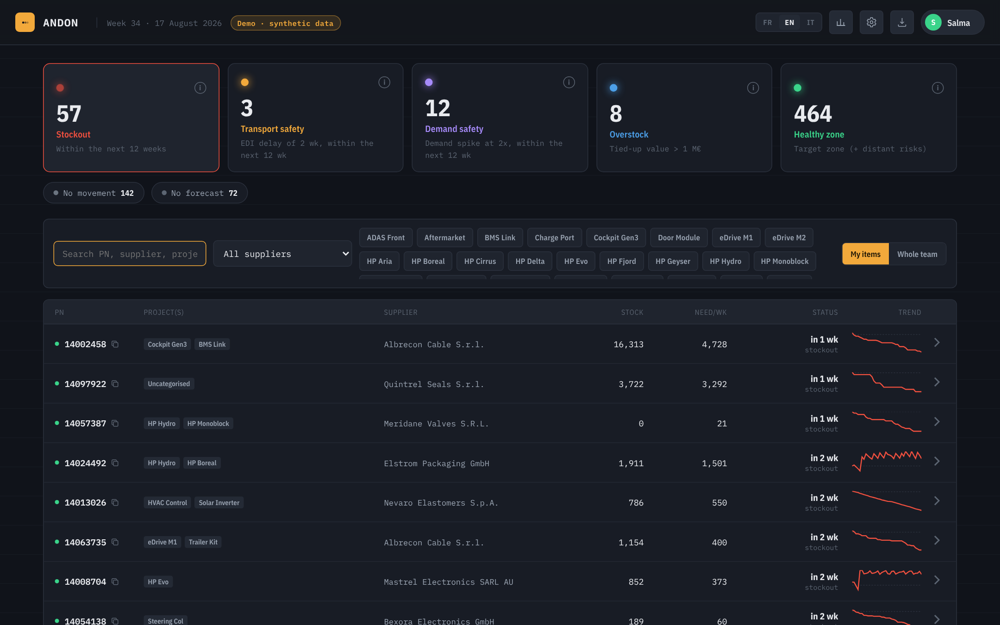
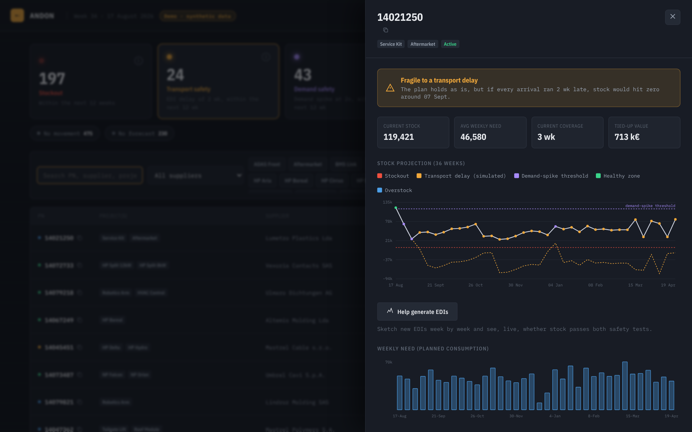
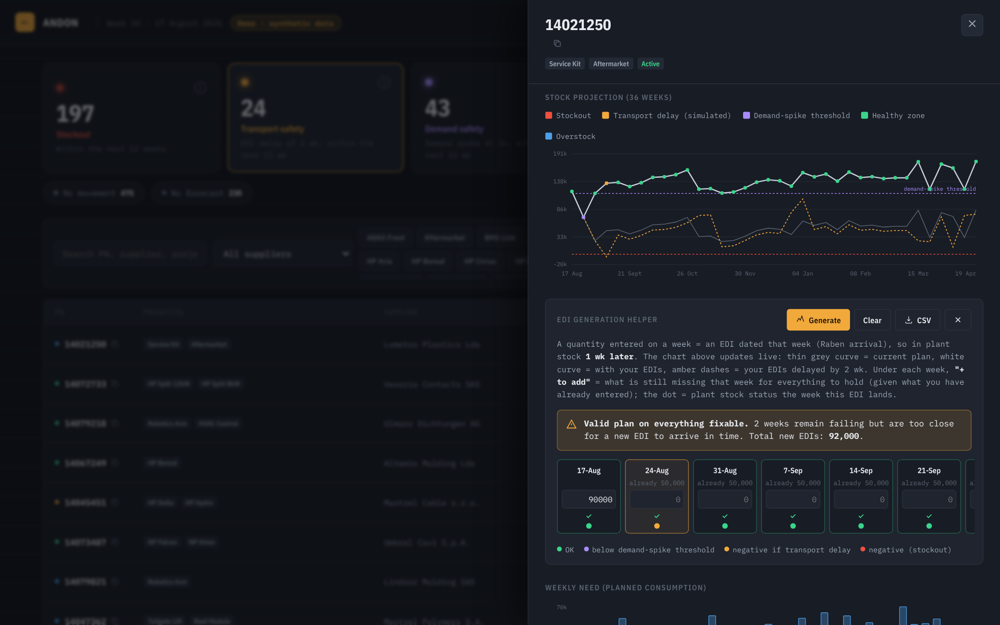
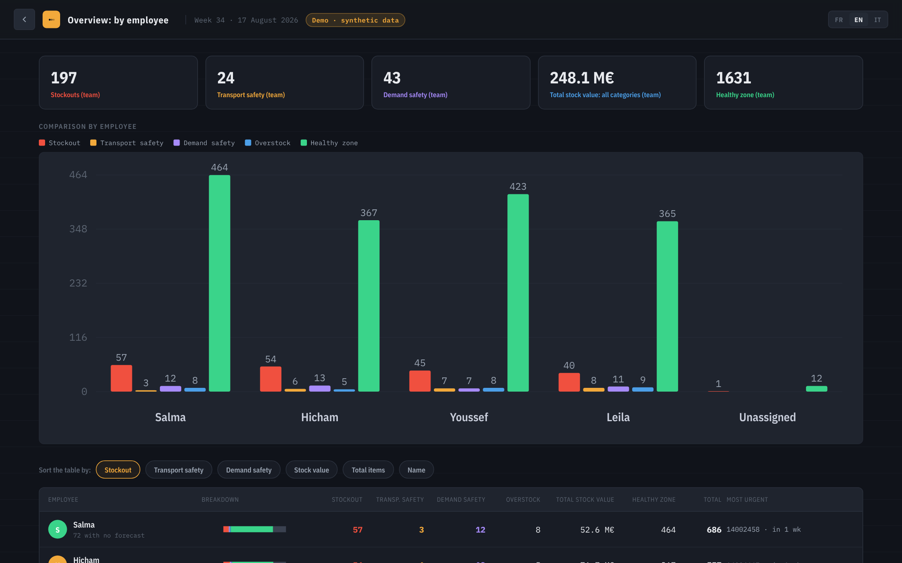

# ANDON: Raw Materials Radar

A single-file web app that turns a weekly supply-planning workbook into a priority radar: which raw materials are about to run out, which ones would not survive a late truck or a demand spike, and which ones tie up too much cash. It also helps the planner fix what it finds, with a live delivery-schedule (EDI) planner.

Built during a supply chain internship at a manufacturing plant, for the planners who convert the production plan into supplier delivery schedules.

**About the data.** The data in this repository is synthetic. It was built from a real planning workbook: same sheets, columns and layout, similar orders of magnitude (number of parts, share of each risk category, spread of prices and volumes). Every value was then generated randomly, so no real part number, supplier, name, price or quantity appears here.



## Try it

**Live demo:** https://adamaqasbiouahi.github.io/andon-raw-materials-radar/?demo&lang=en opens the app with the synthetic sample already loaded. Pick a planner, or view the whole team.

To serve it yourself, enable GitHub Pages on the repo (*Settings → Pages → Deploy from branch → root*). Two URL options exist: `?demo` loads the sample at once, `?lang=fr|en|it` sets the language. Without `?demo`, the home screen has a **Load the demo** button.

To run it locally, open `index.html` in a browser and drop `sample-data/supply_management_34-2026_sample.xlsx` on the upload zone. (The demo button needs the page to be served over http: a page opened from disk cannot fetch a neighbouring file.)

No install, no account. Files are parsed in the browser and never leave the machine. An internet connection is only needed to load two parsing libraries and the fonts from public CDNs.

## What it does

Every part number lands in exactly one category, tested in this order:

| Category | Rule (defaults, all adjustable in ⚙) |
|---|---|
| **Stockout** | Projected stock goes below 0 within the next 12 weeks. |
| **Transport safety** | No stockout in the plan, but if every open delivery arrived 2 weeks late, stock would go below 0 within 12 weeks. |
| **Demand safety** | Survives the delay test, but within 12 weeks projected stock drops below 2 × the heaviest consumption week of that period. |
| **Overstock** | Unit price × projected stock, summed over the 36-week horizon, exceeds €1M. Measures cash tied up over time rather than a one-week peak. |
| **Healthy zone** | Everything else. Risks further out than 12 weeks are kept here and flagged as "distant", so the urgent lists stay short. |

Two side lists complete the picture: **No movement** (no stock, no need) and **No forecast** (in the master data, absent from the plan).

The two safety tests are independent: a part has to survive a late delivery *or* a demand spike, never both stacked.

### Item sheet

Stock projection over 36 weeks with the zero line, the demand-spike threshold and the "everything 2 weeks late" scenario, weekly consumption, open orders, master data.



### EDI planner

Type quantities week by week and watch the projection move. Under each week the app shows what is still missing for the plan to pass both safety tests, and a verdict updates live. **Generate** fills in a just-in-time minimum plan: each delivery week covers exactly the weeks it is the last one able to save, rounded up to a lot size inferred from the part's volume, with the rounding surplus carried forward. The plan exports to CSV.



### Team overview

Per-planner comparison of the five categories and of the stock value each planner manages.



### Also

- Interface in French, English and Italian, switchable at any time.
- Filters by project, supplier and free text; CSV export of any view.
- Thresholds adjustable live: urgency horizon, simulated delay, spike multiplier, overstock value.

## Input format

One Excel workbook (extra sheets are ignored) or the same three sheets as CSV files. Sheets and columns are found by name, so header rows can move and week columns can shift from one export to the next.

| Sheet | What the app reads |
|---|---|
| `Need` | `PN`, weekly consumption (`CW 34` … with the week dates on the row above), `All Stock`, `Raben` (stock already at the logistics hub), then the projected stock per week. |
| `New R` | Master data per part: `Appro` (planner), `supplier`, `Project`, `Status`, `mm60` (unit price), plus descriptive fields. |
| `Open Orders` | One row per scheduling agreement: `SA`, `Material`, `Supplier`, `Backlog`, then one column per delivery week. |

Conventions the app relies on:

- Only part numbers starting with `1` are raw materials; other rows (finished and semi-finished goods) are dropped.
- A delivery is dated at its arrival at the logistics hub and reaches the plant one week later.
- The consumption table may start one week after the stock table. The offset is detected from the week labels of each file.
- Dates and delays ("in 3 weeks", chart axis, plant arrivals) are counted from the file's own week, read from the week dates of the `Need` sheet. An older export, or the sample, therefore reads the same whenever it is opened; the top bar flags a file that is not the current week's.

## Sample data

`sample-data/` holds a fictional plant: 2,400 raw materials, 1,500 finished-goods rows to exercise the filter, 150 suppliers, 4 planners. On load it yields 197 stockouts, 24 transport-safety and 43 demand-safety items, 30 overstocks, 1,631 healthy items and 475 without movement.

It is a snapshot of week 34 of 2026, produced by `tools/generate_sample_data.py`. The generator reproduces the format and the orders of magnitude of a real planning workbook, then draws every value from random distributions: identifiers, suppliers, planners and projects are invented, and no real figure is copied. The result is internally consistent the way a real planning file is: each week's projected stock equals the previous week's, minus consumption, plus the deliveries landing that week.

```bash
pip install -r tools/requirements.txt
python tools/generate_sample_data.py            # same seed, same data
python tools/generate_sample_data.py --seed 7   # a different fictional plant
```

## How it is built

- One HTML file, vanilla JavaScript, no build step and no framework.
- Charts are hand-written SVG.
- [PapaParse](https://www.papaparse.com/) and [SheetJS](https://sheetjs.com/) read the files, loaded from cdnjs.

## Known limits

- With CSV input, unit prices carry only the decimals the spreadsheet displayed. The Excel path reads exact values; prefer it.
- The source format carries no minimum order quantity or lot size, so **Generate** rounds to an inferred unit. Its output is a calculation aid, not a purchase order.
- Backlog (late, undated orders) is displayed but not included in the projection.

## Repository layout

```
index.html                      the app
sample-data/                    synthetic workbook + the same data as 3 CSV files
tools/generate_sample_data.py   sample-data generator
docs/screenshots/               images used in this README
```
